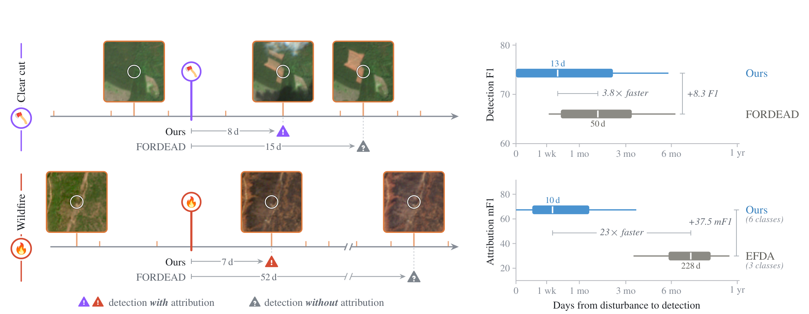

# ODADi: Online Detection and Attribution of Forest Disturbances

Detect forest disturbances and attribute their cause from Sentinel-1 and Sentinel-2 time series, as new images arrive.

**Coming soon (December 2026):** the benchmark dataset, code and model weights.

- Demo data (coming soon): [huggingface.co/datasets/embed2scale/odadi-demo](https://huggingface.co/datasets/embed2scale/odadi-demo)
- Benchmark dataset (coming soon): huggingface.co/datasets/embed2scale/odadi
- Contact: Damien Robert, University of Zurich, damien.robert@uzh.ch

## Acknowledgements

This work is part of the [Embed2Scale](https://embed2scale.eu) project, funded by the European Union's
Horizon Europe programme under grant agreement No 101131841, and by the Swiss State Secretariat for
Education, Research and Innovation (SERI).
